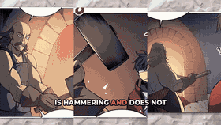
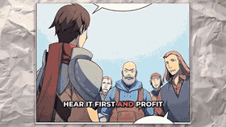

<h3 align="left">Welcome to Satisfy:</h3>

[Open interactive segments](http://www.ycechung.top/ycechungAi/segments.html) · [Watch on YouTube](https://www.youtube.com/watch?v=mqb6pXmRKhs)

<!-- auto-hidden for now (keep code): thumbnail image fallback

-->
<!-- auto-hidden for now (keep code): segments 2-3

-->
<i>My book is life and my imagination is my teacher - Y.C. Eugene Chung</i>
